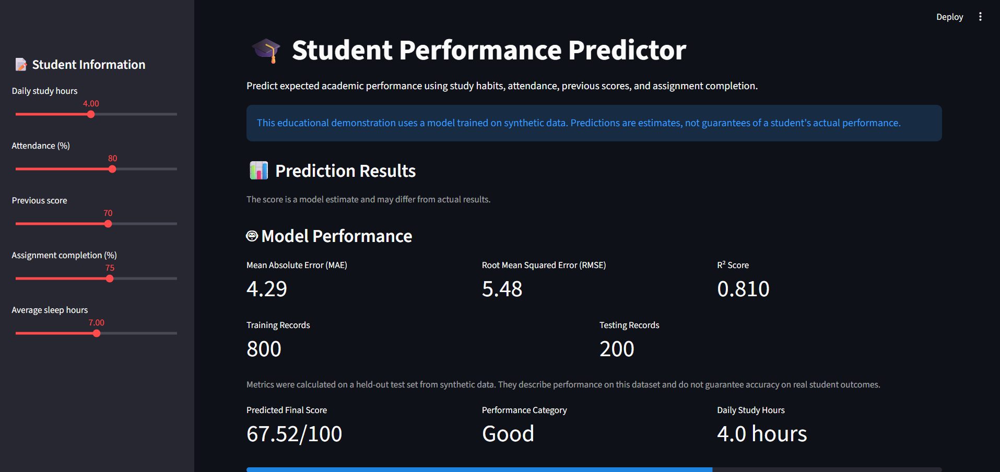
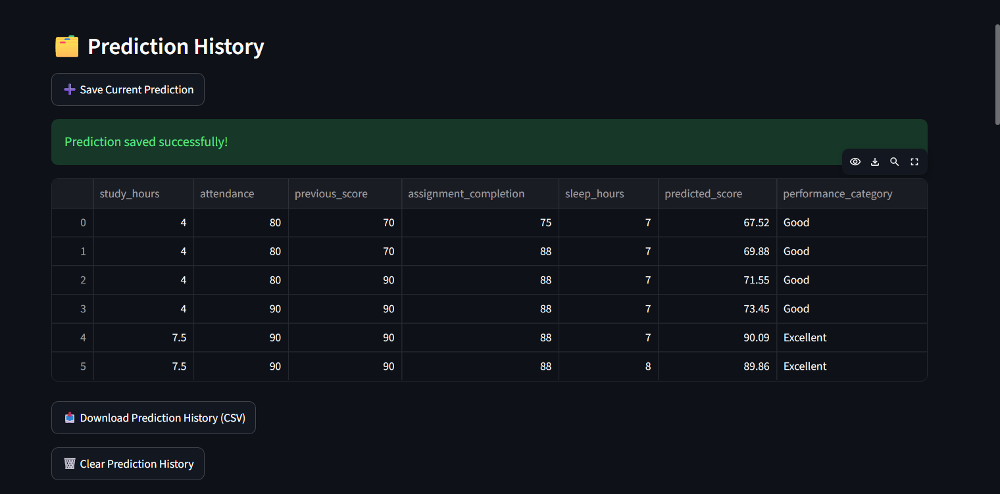
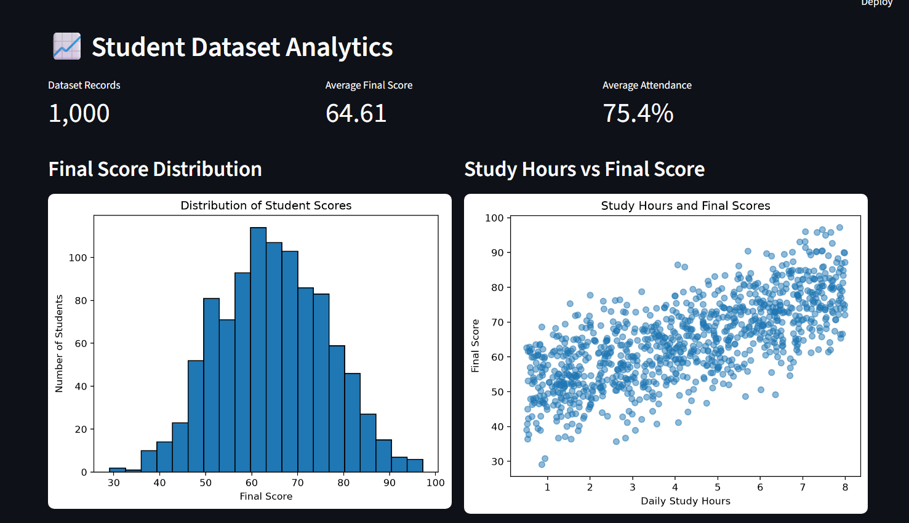

# 🎓 AI-Based Student Performance Prediction

[](https://github.com/prashantranjanop-art/student-performance-prediction/actions/workflows/tests.yml)

An interactive machine learning application that estimates student academic performance using study habits, attendance, previous scores, assignment completion, and sleep duration.

**Live Demo:** [Open Student Performance Predictor](https://student-performance-prediction-we9wqmajereaupbt67ruke.streamlit.app/)

**GitHub Repository:** [Student Performance Prediction](https://github.com/prashantranjanop-art/student-performance-prediction)

> **Disclaimer:** This educational project uses synthetic data generated for demonstration purposes. Its predictions are estimates and do not establish accuracy on real student records or guarantee actual academic outcomes.

## 📌 Project Overview

The Student Performance Predictor demonstrates how machine learning can be integrated into a web application to explore academic performance.

Users can enter student-related information, generate an estimated final score, review model evaluation metrics, explore performance analytics, and download reports.

The application also includes authentication and cloud-based prediction storage using Supabase.

## ✨ Key Features

### 🤖 Machine Learning

* Predict estimated final academic scores using a Random Forest Regressor.
* Classify predictions into four performance categories: Needs Improvement, Average, Good, and Excellent.
* Display model evaluation metrics, including MAE, RMSE, and R².
* Compare actual and predicted scores on a synthetic test dataset.

### 📊 Interactive Dashboard

* Adjust study hours, attendance, previous score, assignment completion, and sleep duration.
* Explore student dataset statistics and score distributions.
* Visualize relationships between study hours and final scores.
* Compare saved prediction records using interactive charts.

### 🔐 Authentication and Prediction History

* Register and sign in using Supabase Authentication.
* Save prediction records in a database.
* Retrieve and compare saved predictions.
* Use Supabase Row Level Security policies to protect user-owned records when configured correctly.

### 💡 Personalized Insights

* Identify positive indicators based on configurable thresholds.
* Generate rule-based study and academic recommendations.
* Explain the predicted score and performance category.
* Distinguish model estimates from actual academic outcomes.

### 📄 Reports and Exports

* Download prediction history and comparison data as CSV files.
* Export personalized student insights.
* Generate downloadable PDF reports containing prediction details, charts, recommendations, and model evaluation metrics.

## 🛠️ Technologies Used

| Technology                | Purpose                               |
| ------------------------- | ------------------------------------- |
| Python                    | Application development               |
| Scikit-learn              | Machine learning model                |
| Pandas                    | Data processing and analysis          |
| NumPy                     | Numerical operations                  |
| Matplotlib                | Data visualizations and report charts |
| Streamlit                 | Interactive web dashboard             |
| Supabase                  | Authentication and cloud database     |
| SQLite                    | Local prediction storage              |
| ReportLab                 | PDF report generation                 |
| Joblib                    | Saving and loading the trained model  |
| Git and GitHub            | Version control and project hosting   |
| Streamlit Community Cloud | Application deployment                |

## 📂 Project Structure

```text
student-performance-prediction/
├── app.py
├── auth.py
├── database.py
├── train_model.py
├── requirements.txt
├── README.md
├── data/
│   └── student_performance.csv
├── models/
│   └── student_performance_model.pkl
├── notebooks/
├── src/
│   ├── __init__.py
│   └── generate_data.py
└── screenshots/
    ├── dashboard.png
    ├── prediction_history.png
    └── analytics.png
```

The project may contain additional configuration and development files. Local secrets should not be committed to the repository.

## 📊 Dataset

The project uses a synthetic dataset containing 1,000 records.

| Feature                 | Description                                         |
| ----------------------- | --------------------------------------------------- |
| `study_hours`           | Daily study hours                                   |
| `attendance`            | Attendance percentage                               |
| `previous_score`        | Previous academic score                             |
| `assignment_completion` | Percentage of assignments completed                 |
| `sleep_hours`           | Average daily sleep duration                        |
| `final_score`           | Generated final score used as the prediction target |
| `performance`           | Performance category derived from the score         |

The dataset is intended for demonstration and experimentation. Its patterns may not represent real-world student populations.

## 🧠 Machine Learning Model

The application uses a Random Forest Regressor from Scikit-learn to estimate final scores.

### Model Configuration

| Parameter            | Value |
| -------------------- | ----: |
| Number of estimators |   200 |
| Maximum depth        |    12 |
| Test set size        |   20% |
| Random state         |    42 |

### Model Evaluation

The current saved model reports the following evaluation results:

| Metric                         | Result |
| ------------------------------ | -----: |
| Mean Absolute Error (MAE)      |   4.29 |
| Root Mean Squared Error (RMSE) |   5.48 |
| R² Score                       |  0.810 |

These metrics were calculated on a held-out test set from synthetic data. They describe the model's results on that dataset and should not be interpreted as evidence of equivalent accuracy on real student outcomes.

## ⚙️ Installation and Local Setup

### 1. Clone the repository

```bash
git clone https://github.com/prashantranjanop-art/student-performance-prediction.git
cd student-performance-prediction
```

### 2. Create a virtual environment

On Windows PowerShell:

```powershell
python -m venv .venv
```

### 3. Activate the environment

```powershell
.\.venv\Scripts\Activate.ps1
```

If PowerShell blocks activation, use the environment's Python executable directly.

### 4. Install dependencies

```powershell
python -m pip install -r requirements.txt
```

### 5. Check the dataset and trained model

The repository should contain:

```text
data/student_performance.csv
models/student_performance_model.pkl
```

If the dataset is missing, generate it:

```powershell
python src/generate_data.py
```

If the trained model is missing, train it:

```powershell
python train_model.py
```

### 6. Start the application

```powershell
python -m streamlit run app.py
```

Open the local address displayed in the terminal.

When Supabase secrets are not configured, the application is intended to use local SQLite storage. When Supabase is configured, the application uses the cloud authentication and database integration.

## ☁️ Supabase Configuration

To enable authentication and cloud prediction storage, create a Supabase project and configure the application secrets.

Create this local file:

```text
.streamlit/secrets.toml
```

Add your own configuration:

```toml
[supabase]
url = "YOUR_SUPABASE_PROJECT_URL"
key = "YOUR_SUPABASE_PUBLISHABLE_KEY"
```

Replace both placeholders with your actual project values.

The predictions table must exist in Supabase with the columns required by `database.py`, including `user_id`.

Configure Supabase Authentication and Row Level Security policies to enforce access to each user's records.

**Security requirements:**

* Never commit `.streamlit/secrets.toml` to GitHub.
* Never expose a Supabase secret or `service_role` key in the application.
* Keep database access controlled by Row Level Security.
* Do not rely only on application-level filtering to protect private records.
* Avoid storing real students' sensitive personal information in this demonstration project.

Existing SQLite records are not automatically migrated to Supabase.

## 🌐 Deployment

The application is deployed using Streamlit Community Cloud.

To deploy your own copy:

1. Fork or clone the GitHub repository.
2. Sign in to Streamlit Community Cloud with GitHub.
3. Create an application from the repository.
4. Select the `main` branch and `app.py` as the main file.
5. Configure the required Supabase secrets in the app's settings.
6. Deploy the application and test authentication, prediction saving, database access, and report downloads.

Deployments depend on the compatibility of the configured Python version and the packages listed in `requirements.txt`.

## 📸 Application Screenshots

### Main Dashboard



### Prediction History



### Dataset Analytics


## 🔍 Limitations

* The training dataset contains synthetic educational data.
* Prediction results are estimates, not guaranteed examination results.
* Model evaluation metrics may change when the dataset or model configuration changes.
* Personalized suggestions use predefined rules rather than independently validated educational research.
* The project does not establish causal relationships between study habits and academic performance.
* Cloud prediction history depends on correct authentication, database configuration, and Row Level Security policies.

## 🛣️ Future Improvements

- Expand automated test coverage to include authentication and database security integration tests.
- Improve model validation and experiment tracking.
- Evaluate the model using suitable real-world educational data when authorized and ethically collected.
- Improve accessibility and user-interface testing.
- Add monitoring for authentication, database, and deployment failures.

## 👨‍💻 Author

Developed as an AI and Machine Learning portfolio project.

## 📜 License

No open-source license has been specified yet. Add a suitable license before granting others explicit permission to reuse, modify, or distribute this project.
